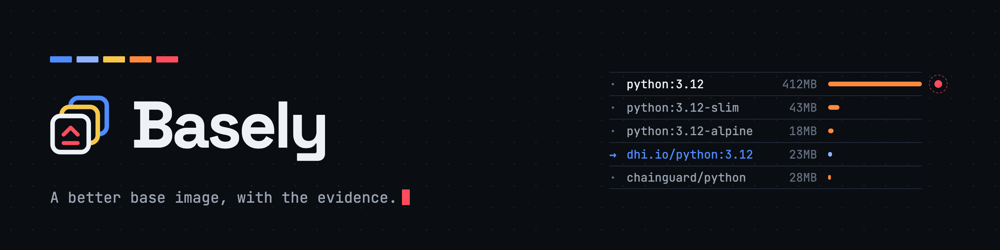
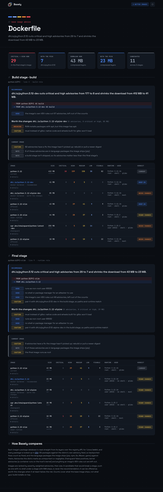
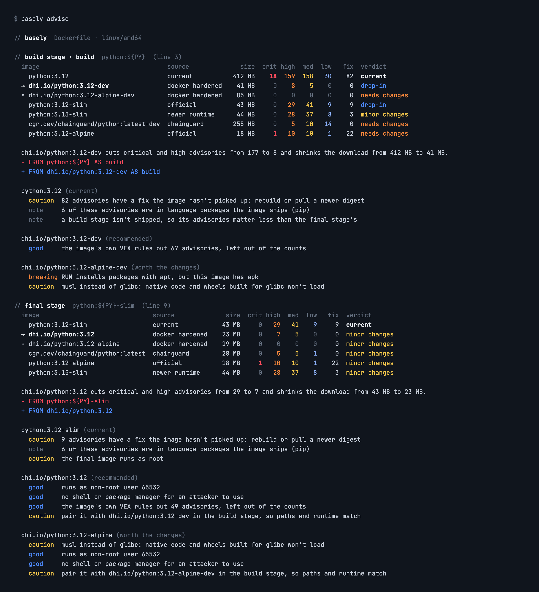

[](https://github.com/fullstackspectrum/basely)

[](https://github.com/fullstackspectrum/basely/actions/workflows/build.yml)
[](https://pypi.org/project/basely/)
[](https://pypi.org/project/basely/)
[](https://github.com/fullstackspectrum/homebrew-basely)
[](https://hub.docker.com/r/fullstackspectrum/basely)
[](https://github.com/fullstackspectrum/basely/blob/main/LICENSE)

# Basely

**A better base image, with the evidence.**

Point Basely at a Dockerfile and it compares each `FROM` with the alternatives: official `-slim` and `-alpine` variants, [Docker Hardened Images](https://dhi.io), [Chainguard](https://images.chainguard.dev) images, and newer releases of the same runtime. For every candidate it reports:

- **Vulnerabilities**, by severity, from [OSV](https://osv.dev): the distro's own advisory feed for OS packages, so backported fixes count as fixed, plus the language packages the image ships (pip, npm, Go modules and the Go standard library, Maven JARs, gems). Where the image publishes VEX, advisories its vendor rules out are left out.
- **Size**, as the compressed download.
- **Fit with your Dockerfile.** A build stage with `RUN apt-get` needs a shell and apt, so a distroless image or an Alpine one would break it. Basely checks that, along with glibc versus musl, runtime version, user, platforms and image age.

Then it recommends the best image that won't break the stage, shows the `FROM` line to change, and offers a stronger option that's worth some changes when there is one.

Basely never pulls an image. It reads manifests and package databases straight from the registry, using your existing `docker login`. It has no runtime dependencies and needs Python 3.10 or later, or 3.14 to read the zstd-compressed layers Docker Hardened Images use.

> Basely is a sibling of [Vulnly](https://github.com/fullstackspectrum/Vulnly) and [Sbomly](https://github.com/fullstackspectrum/sbomly), and part of [Full-Stack-Spectrum](https://fullstackspectrum.com/): small open-source tools that turn noisy supply chain data into decisions.



## Install

```bash
pipx install basely     # or: pip install basely
brew install fullstackspectrum/basely/basely
```

Or run the container image from the directory that holds your Dockerfile:

```bash
docker run --rm -t -v "$PWD:/data" fullstackspectrum/basely advise
```

The container can only use registry logins stored in `~/.docker/config.json` itself (mount it with `-v ~/.docker:/docker:ro`), not ones kept in a credential helper such as Docker Desktop's. Without a login, add `--only official,chainguard` to skip Docker Hardened Images.

## Usage

```bash
basely advise                      # reads ./Dockerfile
```

Each stage gets a comparison table, the recommendation as a `FROM` diff, and the notes that matter: what's wrong with the current image, and what to watch for in the pick.



Write reports alongside the terminal output:

```bash
basely advise --html advice.html --markdown advice.md --json advice.json
```

Advise on an image without a Dockerfile, or compare images you name:

```bash
basely advise --image node:22                      # as a shipped runtime image
basely advise --image node:22 --role build         # as a base you RUN commands on
basely compare python:3.12 python:3.12-slim dhi.io/python:3.12 cgr.dev/chainguard/python
```

Include your own golden images, or narrow the sources:

```bash
basely advise --with registry.example.com/base/python:3.12
basely advise --only official,hardened
basely advise --platform linux/arm64
basely advise --vex our-exceptions.openvex.json    # apply your own VEX
basely advise --os-only                            # skip language packages
```

## How it decides

**Stage roles.** A stage that runs commands is a *build* role: it needs a shell, and the package manager its `RUN` steps use. The final stage with no `RUN` steps is the *runtime* role: there, no shell and no package manager are strengths. Basely suggests `-dev` variants for build stages and minimal variants for runtime ones. It also reminds you to pair a hardened or Chainguard final image with the same vendor's `-dev` image in the build stage, so copied files land in the same paths.

**Verdicts.**

| Verdict | Meaning |
| --- | --- |
| drop-in | Nothing in the stage should break |
| minor changes | Works, but something differs: musl instead of glibc, a newer runtime, a non-root user, a missing platform, an old build |
| needs changes | Would break the stage: no shell under `RUN`, or a different package manager |
| unavailable | Couldn't be read: not found, or needs a login |

**Ranking.** Candidates are ranked by severity-weighted advisories (critical 10, high 5, medium 2, low and unscored 1), then size. The recommendation is the best drop-in, or failing that the best with minor changes, and only if it beats the current image. A candidate that needs more work is offered as *worth the changes* when it at least halves the risk.

**What's counted.**

- **OS packages** from the image's package database (dpkg, including distroless's `status.d`, and apk), looked up under the distro's ecosystem: Debian, Ubuntu, Alpine, Wolfi and Chainguard.
- **Language packages**: Python `site-packages` (dist-info and egg-info), `node_modules`, the build info embedded in Go binaries (modules and the Go standard library), `pom.properties` in JARs (nested Spring Boot and WAR JARs too) and RubyGems specifications. Anything the distro's package manager installed is skipped, because its advisories already cover it. `--os-only` turns this off.

**What's left out.**

- Advisories the distro marks as unimportant or negligible, and Chainguard's false positives.
- Kernel advisories: a container runs on the host's kernel, whatever headers the image carries.
- Advisories ruled out by **VEX**. Basely fetches OpenVEX attestations attached to each image through the OCI referrers API, as Docker Hardened Images publish them, and applies them: `not_affected` and `fixed` take an advisory out of the counts, `under_investigation` marks it. Add your own OpenVEX documents with `--vex FILE`, or ignore images' VEX with `--no-vex`.

**Severity** comes from the CVSS 3.x vector when there is one, then CVSS 4.0 (scored with a port of FIRST's reference calculator), then the distro's or GitHub's own label, then the upstream CVE record.

## CI

`--fail-on` turns the advice into a gate:

| Category | Fails when |
| --- | --- |
| `fixable` | the current image has advisories a rebuild or pull would fix |
| `critical` | the current image has a critical advisory |
| `better` | Basely recommends a different image |
| `root` | the final image runs as root and the Dockerfile doesn't set `USER` |

Exit codes: `0` passed, `1` a `--fail-on` category occurred, `2` bad usage or an unreadable Dockerfile or image.

### GitHub Actions

Basely ships as a composite action. It writes the Markdown advice to the job page, and exposes the report paths for a PR comment or artifact upload.

```yaml
- uses: docker/login-action@v3       # optional: lets Basely read dhi.io images
  with:
    registry: dhi.io
    username: ${{ secrets.DOCKERHUB_USERNAME }}
    password: ${{ secrets.DOCKERHUB_TOKEN }}
- uses: fullstackspectrum/basely@v0
  with:
    dockerfile: Dockerfile
    fail-on: critical,root
```

## Caching

Image facts are cached by digest in `~/.cache/basely` (or `$XDG_CACHE_HOME/basely`, or `$BASELY_CACHE_DIR`) and never go stale. OSV advisories are cached for a day. A second run over the same images takes a second or two. `--no-cache` skips the cache.

## Development

```bash
uv venv -p 3.14 && uv pip install -e ".[dev]"
.venv/bin/python -m pytest -q                      # offline: fake registry and OSV
.venv/bin/python docs/screenshots/src/render.py    # README screenshots (network, Chrome)
./docs/brand/src/render.sh                         # README banner and social preview
```

## License

Apache-2.0. The embedded Space Grotesk and JetBrains Mono fonts are under the SIL Open Font License 1.1; their licence files are in `basely/assets/`.
