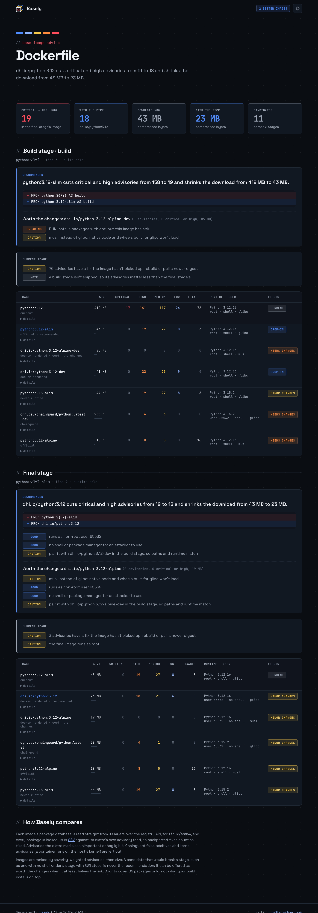

# Basely

**A better base image, with the evidence.**

Basely compares each `FROM` in a Dockerfile with official slim and Alpine variants, Docker Hardened Images, Chainguard images and newer runtimes. It reports vulnerabilities from OSV, size, and whether each candidate fits the stage, then recommends the best one that won't break your build.

Source, docs and issues: https://github.com/fullstackspectrum/basely



## Usage

Run it from the directory that holds your Dockerfile:

```bash
docker run --rm -t -v "$PWD:/data" fullstackspectrum/basely advise
docker run --rm -t -v "$PWD:/data" fullstackspectrum/basely advise --html advice.html
docker run --rm -t fullstackspectrum/basely compare python:3.12 python:3.12-slim
```

The `-t` flag gives you colour in the terminal. Drop it in CI logs.

Docker Hardened Images need a login. The container reads logins stored inline in `config.json`, not ones in a credential helper:

```bash
docker run --rm -t -v "$PWD:/data" -v ~/.docker:/docker:ro fullstackspectrum/basely advise
```

Without one, add `--only official,chainguard`.

## Tags

| Tag | Points to |
| --- | --- |
| `latest` | The newest stable release |
| `X` (e.g. `1`) | The newest release in that major series |
| `X.Y` (e.g. `0.1`) | The newest patch release in that minor series |
| `X.Y.Z` (e.g. `0.1.0`) | One exact release |

Every tag is built for `linux/amd64` and `linux/arm64`. Pre-releases are published under their exact version only and never move `latest`.

## Image

Built on Docker Hardened Images' Python 3.14 Alpine runtime: no shell, no package manager, and it runs as the non-root user 65532.
